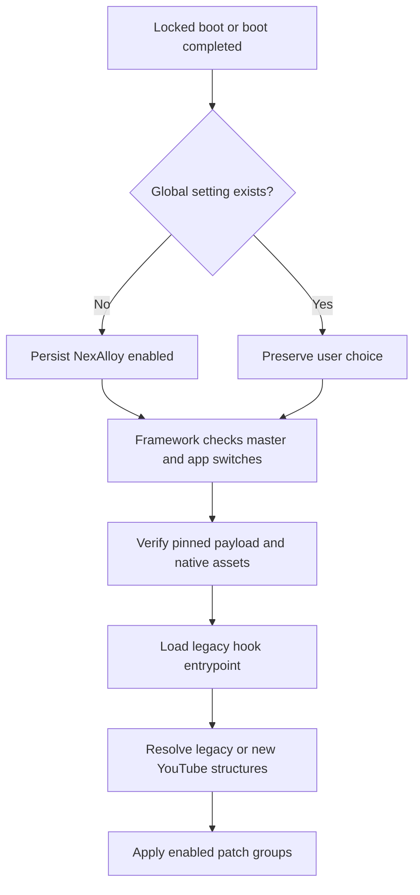

# NexAlloy YouTube compatibility and first-boot default

## Result
YouTube 21.41.525 on HyperOS 4 / Android 17 loads all 21 public patch groups.
The device owner confirmed that playback continues after Home/screen lock and
that the app works normally. This confirms background playback, not every
server-dependent feature such as ad delivery or SponsorBlock coverage.

## Evidence chain
- E-01: Initial runtime log: native engine/entrypoint succeeded, then three fingerprint
  families failed (background category, player type, Shorts startup), causing dependency failures.
- E-02: Current APK analysis: enum setter moved to the player view; background
  label moved into a merged function; the Shorts constructor-scoped call was inlined.
- E-03: Final process log resolves the new background gate and records 21/21 applied
  feature statuses, without fingerprint or dependency exceptions.
- E-04: The connected-device framework was freshly extracted. Only classes7.dex and
  ntmanager/NTNexAlloy.apk changed; the framework class-definition set was preserved.
  All nine payload checksums and the three Xiaomi smali exports were verified.
- E-05: Controller boot receiver: unset key -> 1; explicit 0 -> remains 0.
  Master setting remained enabled after the actual device reboot.
- E-06: Owner confirmed background playback and normal app operation.
- E-07: Both OPlus main/PT exports match the verified runtime, APK, controller and
  metadata byte for byte; their existing native assets match all eight library pins.
  No ColorOS device test was performed in this HyperOS session.

## Changes
Apply compat/b61974f/youtube-21.41.patch after legacy-entrypoint.patch.
It retains legacy matching and introduces structural fallbacks, then invalidates
DexKit result caches with ntcompat2. Runtime cache/pin version is
2.0.110-b61974f-compat2. Native hook engine binaries are unchanged.

The privileged controller receives LOCKED_BOOT_COMPLETED and BOOT_COMPLETED,
writing nt_nexalloy_enabled=1 only if no global value exists. It preserves an
explicit off value and all app/feature switches. Its Android boot permission and
existing WRITE_SECURE_SETTINGS privileged grant are required.

Updated toolbuilds: Xiaomi, OPlus main, OPlus PT. NTManager stays at v1.46;
only the NexAlloy controller/payload/runtime integration changed here.

## Call flow

## Device validation and rollback
A checksum-guarded mount module was built from the current framework and remains
installed for testing. Disable nt_nexalloy_youtube_hyperos_test to restore the ROM
framework. KernelSU's unmount-modules option must be disabled for YouTube during
module testing; the ROM-integrated files do not require that setting or root.
The initial mount-hidden checksum rejection was resolved by the owner changing
that profile. Hash checks were retained.

Validation used runtime status, boot-default checks and the owner's physical
playback test. No full ROM build, exhaustive feature test or ColorOS boot test was
performed for this change.
